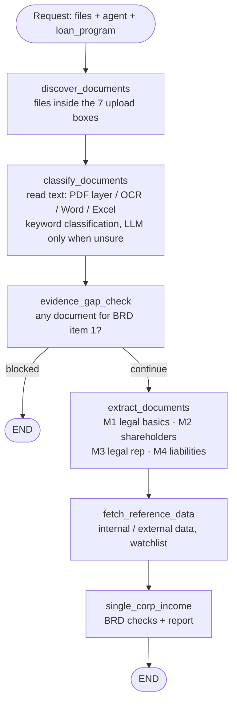

# Corp Income — Pháp lý doanh nghiệp (BRD mục 1–4)

A **LangGraph** pipeline for the corporate (KHDN) legal check of the BRD *Corp Income
Assessment*, use case **"Pháp lý doanh nghiệp"**, items 1–4. Built on the structure of
[SME-creditmemo-multi-agent `refactor/ui-driven-inputs`](https://github.com/hodongtu/SME-creditmemo-multi-agent/tree/refactor/ui-driven-inputs):
the same graph, the same upload boxes, the same `Config` / `build_llm` / `config/prompts`
layout and the same notebook. The upload screen supplies the customer's files, the **agent**
(`CORP_INCOME_AGENT`) and the **loan program** (`KHDN`); the pipeline does the rest:
OCR → document classification → evidence-gap check → structured extraction (one pass per BRD
item) → BRD checks → a Vietnamese report, an Excel workbook and the OCR text of every file.

The entry point is the notebook [local_underwriting_agents.ipynb](local_underwriting_agents.ipynb);
all logic lives in the importable package [src/](src/).

---

## Table of Contents

- [Key Features](#key-features)
- [What it checks (BRD items 1–4)](#what-it-checks-brd-items-14)
- [Architecture Overview](#architecture-overview)
- [Agent Processing Workflow](#agent-processing-workflow)
- [Project Structure](#project-structure)
- [Installation](#installation)
- [Configuration (.env)](#configuration-env)
- [Running It](#running-it)
- [Outputs](#outputs)
- [Report template](#report-template)
- [Tests](#tests)
- [Known limits](#known-limits)

---

## Key Features

- **Same deterministic pipeline as the SME repo**: every step is a LangGraph node and no LLM
  decides which step runs next.
- **Same seven upload boxes** (`ho_so_phap_ly`, `ho_so_tai_chinh`, `ho_so_vay_von`,
  `ho_so_tai_san_dam_bao`, `ho_so_noi_bo`, `ho_so_soan_thao_noi_bo`, `ho_so_khac`). A file outside
  every box is named in a warning and not processed.
- **Reads what corporate dossiers arrive as**: digital PDFs from their **text layer** (no OCR
  needed), scanned PDFs and **phone photos** through Tesseract, **Word (.docx)**, Excel/CSV, TXT.
- **Four structured-extraction passes, one per BRD item**, each declared once in
  `EXTRACTION_PASSES` and run only on the document types the matrix flags for it.
- **BRD checks in code** (`src/agents/calculator/legal_checks.py`): exact MST match, 12-month
  windows, ownership totals, borrower's recent capital acquisition, legal-rep changes, open
  tax/BHXH debts. The LLM extracts; code checks and writes — the same input always gives the same
  report.
- **Evidence-gap check before spend**: no legal document at all → the run stops and says so before
  a single extraction call.
- **One switch for the LLM**: `LLM_PROVIDER=openai | anthropic | databricks`.

---

## What it checks (BRD items 1–4)

| BRD | Sub-component | Output | Key checks |
|---|---|---|---|
| 1 | Thông tin cơ bản về pháp lý DN | Legal profile with a source per field | MST khớp tuyệt đối; tên/địa chỉ/vốn/ĐDPL khớp; trạng thái hoạt động; thay đổi trong 12 tháng; dữ liệu nội bộ chưa cập nhật; hoạt động thực tế tại địa chỉ |
| 2 | Cổ đông, thành viên góp vốn | Members (%, capital, acquisition date) | Tổng tỷ lệ = 100%; chuyển nhượng trong 12 tháng; cổ đông pháp nhân; **KH cá nhân mới nhận vốn góp trong 12 tháng → cảnh báo** |
| 3 | Người đại diện pháp luật | Legal rep(s) and actual operator | **ĐDPL thay đổi trong 12 tháng → cảnh báo**; người điều hành thực tế ≠ ĐDPL (no leadership-capability assessment, per BRD) |
| 4 | Nợ thuế, BHXH, phạt, tranh chấp | Debts, penalties, enforcement, disputes | Còn nợ thuế/BHXH (>90 ngày); xử phạt chưa khắc phục; cưỡng chế; tranh chấp ảnh hưởng hoạt động/TSBĐ |

Every finding is 🔴 cảnh báo · 🟠 cần làm rõ · 🔵 ghi nhận · 🟢 khớp, with the documents it rests
on. The full BRD-step → code mapping is in [docs/technical-solution.md](docs/technical-solution.md).

---

## Architecture Overview

| Module | Role |
|---|---|
| [src/agents/supervisor.py](src/agents/supervisor.py) | **Orchestrator** — builds and runs the LangGraph, prepares documents, runs `EXTRACTION_PASSES` |
| [src/agents/documents/](src/agents/documents/) | Discovery (`document_discovery.py`), keyword classification (`document_classification.py`) — unchanged from the SME repo |
| [src/agents/documents/document_matrix.yaml](src/agents/documents/document_matrix.yaml) | 17 corporate document types in the 7 boxes; which BRD item reads each; `source` of each |
| [src/agents/extraction/](src/agents/extraction/) | The four BRD extraction passes + shared `structured_extraction.py` |
| [src/agents/calculator/legal_checks.py](src/agents/calculator/legal_checks.py) | The BRD B6 checks, deterministic |
| [src/agents/specialist.py](src/agents/specialist.py) | `CORP_INCOME_AGENT`: records → checks → report (no LLM) |
| [src/config.py](src/config.py) | `build_llm` (+ `LLM_PROVIDER`) and `Config` |
| [src/prompts.py](src/prompts.py) | The only reader of `config/prompts/` |
| [src/utils/reading/](src/utils/reading/) | OCR, PDF text layer, Word/Excel/CSV/PPTX/XML readers |
| [src/utils/report/](src/utils/report/) | Report template rendering, Excel export, HTML/PDF export |
| [src/templates/corp-income-structure.md](src/templates/corp-income-structure.md) | The report layout |

---

## Agent Processing Workflow



**Stage 1 — Discovery & classification.** The box a file sits in narrows the candidate types;
keyword scoring (filename hits ×3) picks the type, and the `MODEL_DOCUMENT` LLM is asked only
when the keyword pass is unsure. A file whose content points to another box is flagged
("Possible wrong upload box"). Text is read once per file and the method is recorded
(`pdf_text_layer`, `ocr_pdf`, `ocr_image`, `docx`, `spreadsheet`, `text`).

**Stage 2 — Evidence gap check.** Stops when nothing can feed BRD item 1 (no GCN, charter,
register, lookup, site visit, and no external/internal data). Missing mandatory types (the GCN
ĐKDN) and missing tax documents are reported but do not stop the run.

**Stage 3 — Structured extraction.** Each pass runs on the types the matrix flags for it:

| Pass | Prompt | Model | Runs on |
|---|---|---|---|
| M1 Pháp lý cơ bản | `legal_basic_extraction.md` | `MODEL_PREMIUM` | GCN, điều lệ, sổ cổ đông, tra cứu ĐKDN, dữ liệu nội bộ, báo cáo thực địa |
| M2 Cổ đông | `shareholders_extraction.md` | `MODEL_PREMIUM` | GCN, điều lệ, sổ cổ đông, chuyển nhượng vốn, QĐ bổ nhiệm/nghị quyết, tra cứu, nội bộ, thực địa |
| M3 Người đại diện | `legal_rep_extraction.md` | `MODEL_ECONOMY` | GCN, điều lệ, QĐ bổ nhiệm, tra cứu, nội bộ, thực địa |
| M4 Nợ thuế, tranh chấp | `liabilities_extraction.md` | `MODEL_ECONOMY` | thông báo thuế, BHXH, xử phạt, kiểm tra, tranh chấp, thuyết minh BCTC, tra cứu nợ, thực địa |

Amounts are read as printed with their unit and scaled to đồng in code.

**Stage 4 — Reference data.** `internal_data`, `external_data` (same JSON shape as the
extraction) and a `watchlist` are passed into `process()` until the BCDE/BEP, Cổng ĐKDN and
AML/BL/WL systems are connected; this node is where those queries will go.

**Stage 5 — The agent.** Every extraction becomes a record tagged with its `source`
(customer / field / external / internal); `legal_checks.py` compares the sources and applies the
BRD rules; the report is rendered from `src/templates/corp-income-structure.md`.

---

## Project Structure

```
.
├── local_underwriting_agents.ipynb   # Entry point — driver notebook (same cells as the SME repo)
├── config/
│   └── prompts/                      # Every system prompt, one Markdown file each
├── src/
│   ├── config.py                     # LLM factory (+ LLM_PROVIDER) + Config
│   ├── prompts.py                    # The only reader of config/prompts/
│   ├── types.py                      # Shared types
│   ├── agents/
│   │   ├── supervisor.py             # LangGraph orchestrator + EXTRACTION_PASSES
│   │   ├── specialist.py             # CORP_INCOME_AGENT
│   │   ├── documents/                # discovery, keyword classification, routing matrix
│   │   │   ├── document_matrix.py    # Loads and validates the YAML
│   │   │   └── document_matrix.yaml  # 17 corporate document types in the 7 upload boxes
│   │   ├── calculator/legal_checks.py
│   │   └── extraction/               # legal_basic, shareholders, legal_rep, liabilities
│   ├── utils/
│   │   ├── common.py, paths.py
│   │   ├── reading/                  # ocr.py, extractors.py
│   │   └── report/                   # report_template.py, excel_export.py, visualization/
│   └── templates/                    # corp-income-structure.md
├── samples/<testcase>/               # Uploaded files, one folder per upload box (gitignored)
├── logs/                             # Run outputs (gitignored)
├── testing/                          # unittest
├── scripts/install_tesseract.sh      # Databricks cluster init script
├── docs/                             # technical-solution.md, DATABRICKS.md, the BRD rows (xlsx)
├── .env / .env.example
└── README.md
```

> There are **no `__init__.py` files** under `src/` — it is a namespace package, imported as
> `src.agents.supervisor` from the project root (same as the SME repo).

### System prompts

| File | Placeholder the code fills |
|---|---|
| `legal_basic_extraction.md`, `shareholders_extraction.md`, `legal_rep_extraction.md`, `liabilities_extraction.md` | — |
| `extraction_user.md` | — (the human message: `{filename}`, `{content}`) |
| `document_classification.md` | `{{document_type_catalogue}}`, rendered from the matrix per upload box |
| `document_classification_user.md` | — |

`{{name}}` is a value the code fills, and only that; JSON examples use single braces.
`testing/test_prompts.py` enforces it.

---

## Installation

**System requirements:** Python 3.11+ and **Tesseract OCR** with Vietnamese.

```bash
# macOS
brew install tesseract tesseract-lang
# Ubuntu/Debian (and Databricks: scripts/install_tesseract.sh as a cluster init script)
sudo apt-get install tesseract-ocr tesseract-ocr-vie
```

```bash
pip install -r requirements.txt
```

PDF export of the report needs WeasyPrint's native libraries (see `requirements.txt`); without
them the notebook still saves the `.md`, `.xlsx` and JSON files. Databricks set-up step by step:
[docs/DATABRICKS.md](docs/DATABRICKS.md).

---

## Configuration (.env)

Copy `.env.example` → `.env` (or, on Databricks, set the same names in the notebook's second
cell from `dbutils.secrets`).

```env
LLM_PROVIDER=openai          # openai | anthropic | databricks
MODEL_DOCUMENT=gpt-4o-mini   # classification tie-break
MODEL_ECONOMY=gpt-4o-mini    # BRD items 3-4
MODEL_PREMIUM=gpt-4o         # BRD items 1-2

OPENAI_API_KEY=…   OPENAI_API_BASE=…        # LLM_PROVIDER=openai (or an OpenAI-format gateway)
ANTHROPIC_API_KEY=… ANTHROPIC_BASE_URL=…    # LLM_PROVIDER=anthropic
DATABRICKS_HOST=…  DATABRICKS_TOKEN=…       # LLM_PROVIDER=databricks (MODEL_* = endpoint names)
```

An unset model or key raises at startup **naming the variable**, before any call is made. OCR
settings are the SME repo's, plus `PDF_TEXT_LAYER=1` (read digital PDFs without OCR) and
`OCR_CACHE_DIR` (set it to a Volume to keep OCR between runs).

**Cost per run**: one classification call per document the keyword pass was unsure about, plus
one call per document per BRD item it feeds (a GCN = 3, a tax notice = 1, a site-visit report = 4).
Clear filenames and the right upload box are the biggest levers, exactly as in the SME repo.

---

## Running It

1. Open [local_underwriting_agents.ipynb](local_underwriting_agents.ipynb).
2. **Cell 2** — paths & `load_dotenv`. **Cell 3** (Databricks only) — set the environment from
   `dbutils.secrets`.
3. **Cell 4** — the inputs:
   ```python
   TESTCASE_ID = "case_1"
   LOAN_PROGRAM = "KHDN"
   AGENT = "CORP_INCOME_AGENT"
   INPUT_PATHS = [str(PROJECT_ROOT / "samples" / TESTCASE_ID)]   # or a /Volumes/… folder
   LOAN_DATE = "13/10/2026"            # 12-month checks end here; None = today
   BORROWER_NAMES = ["Nguyễn Văn A"]   # individual borrower(s), BRD item 2
   ```
4. **Cell 5** — builds `Config` with the LLM clients.
5. **Cells 6–8** — import types, document modules, agents.
6. **Cell 9** — `supervisor.process(INPUT_PATHS, agent=AGENT, loan_program=LOAN_PROGRAM, …)`;
   prints the report, the step log, the classification of every document, failed extractions,
   and one conclusion per BRD item.
7. **Cell 10** — writes every artifact to `logs/<testcase>_<timestamp>/`.

---

## Outputs

| File | Content |
|---|---|
| `final_response.md` / `.pdf` | The report |
| `corp_income.xlsx` | Tóm tắt · 1. Pháp lý cơ bản · 2. Cổ đông · 3. Người đại diện · 4. Nợ thuế - tranh chấp · Kiểm tra · Hồ sơ |
| `corp_income.json` | Findings and summary per BRD item, every extraction record (đồng) |
| `legal_basic_extraction.json` … `liabilities_extraction.json` | Each pass's JSON, per document |
| `document_classifications.json` | Classification, source and read method per document |
| `ocr/<file>.txt` | The full text read from each file — check here first when a field is wrong |
| `result.json` | Response, steps, plan, gaps |

---

## Report template

The report is `src/templates/corp-income-structure.md` with `{{placeholders}}` filled in code
(51 names: single fields with `_source`, whole tables, `itemN_findings`, `itemN_conclusion`; the
list is at the top of the file). Replace the file with your own layout — no Python change. An
unknown name renders as "—" and is named in the step log.

---

## Tests

```bash
python -m unittest testing.test_prompts testing.test_config testing.test_document_classification \
    testing.test_reading testing.test_corp_income_workflow testing.test_brd_1610
```

`test_brd_1610` has one test per rule of the BRD of 16/10/2026 (see `docs/CHANGES-BRD-1610.md`).

`test_corp_income_workflow` runs the whole graph on a small dossier with fake extraction chains
(no API key); `test_reading` reads a real digital PDF, a Word file, a scanned PDF and a photo
through Tesseract (skipped if Tesseract is not installed).

---

## Known limits

- No web search (BRD item 1 POC note): save the masothue / Cổng ĐKDN page into `ho_so_noi_bo`,
  or pass the API result as `EXTERNAL_DATA`.
- Fraud detection (tampered documents) is out of scope; AML/BL/WL = match against `WATCHLIST`.
- Customer files and outputs are git-ignored — keep them in a Volume.
